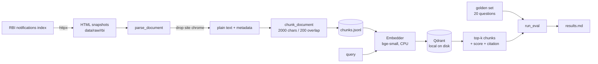

# india-legal-rag

Retrieval over Indian regulatory text — starting with
[Reserve Bank of India notifications](https://www.rbi.org.in/Scripts/NotificationUser.aspx) —
built so that its retrieval quality is **measured rather than asserted**.

Every retrieval number in this repository is produced by a committed evaluation
harness, scored against a versioned golden set of 20 questions with
human-checkable chunk-level labels. The evaluation report is committed next to
the code, and re-running the evaluation rewrites it, so a change that helps and a
change that hurts are both visible in the diff.

This milestone is the retrieval baseline. There is no answer generation, no
citation formatting and no refusal yet; those are the next milestone.

---

## Contents

- [What this is](#what-this-is)
- [Headline results](#headline-results)
- [Quickstart](#quickstart)
- [How it works](#how-it-works)
- [The corpus](#the-corpus)
- [The evaluation harness](#the-evaluation-harness)
- [The golden set](#the-golden-set)
- [Reading the numbers](#reading-the-numbers)
- [The retrieval inspector](#the-retrieval-inspector)
- [Configuration](#configuration)
- [Failure behaviour](#failure-behaviour)
- [Design decisions](#design-decisions)
- [Repository layout](#repository-layout)
- [Development](#development)
- [Reproducing the baseline exactly](#reproducing-the-baseline-exactly)
- [Limitations](#limitations)
- [Roadmap](#roadmap)
- [Documentation](#documentation)

---

## What this is

A retrieval pipeline over a small, real, awkward corpus of Indian regulatory
circulars, plus the machinery to prove whether it works.

The pipeline itself is deliberately unremarkable: fixed-size chunking, a
bi-encoder embedding, and approximate nearest-neighbour search. A dense
baseline is not an interesting engineering achievement and this repository does
not pretend otherwise. What it does claim is that the baseline is *known*: its
quality is quantified per metric and per question, its failures are named, and
the numbers are reproducible from a clone with no network access.

The interesting part is therefore the evaluation layer:

- a golden set whose labels are verifiable by a careful reader who is not a
  lawyer, so maintaining it does not require domain expertise;
- a metric harness that fails loudly rather than reporting a number it cannot
  justify;
- a versioned report (`results.md`) that is the artifact of record;
- a committed corpus snapshot, so the report cannot silently drift from the
  data it describes.

| milestone | scope | state |
| --- | --- | --- |
| 1 | corpus, dense retrieval baseline, evaluation harness, inspector | **this milestone** |
| 2 | answer generation, citations, refusal, model-judge calibration | not started |

### What the system does today

1. Downloads (or reads committed snapshots of) RBI notification pages.
2. Normalises them to plain text and strips the site's navigation and archive
   markup.
3. Splits the text into fixed-size overlapping chunks, carrying source URL,
   circular number and publication date onto every chunk.
4. Embeds chunks locally with `BAAI/bge-small-en-v1.5` on CPU.
5. Stores them in a local on-disk Qdrant collection.
6. Answers a query with the top-k most similar chunks, each with a score and a
   citation.
7. Scores that retrieval against 20 labelled questions and writes `results.md`.

No API key is required and nothing is sent anywhere at runtime.

---

## Headline results

Dense bi-encoder retrieval over the whole corpus. No reranking, no hybrid
search, no query transformation. Measured over 20 questions.

| config | recall@5 | recall@10 | recall@20 | precision@5 | mrr | ndcg@10 |
| --- | --- | --- | --- | --- | --- | --- |
| `dense-fixed` | 0.78 | 0.82 | 0.85 | 0.22 | 0.73 | 0.73 |

`results.md` is the committed output of `python -m legalrag.eval` and is
overwritten by each run.

**Read this with two caveats, both of which are properties of the set, not the
retriever:**

- Two of the twenty questions are unanswerable by design and score zero on
  every retrieval metric. Recall therefore cannot exceed **0.90** on this set,
  and the figures understate quality on the questions that *can* be answered.
  There is no abstention mechanism yet, so there is nothing for those questions
  to score against.
- One answerable question is not retrieved at all, at any depth up to 20
  (`q008`). See [Reading the numbers](#reading-the-numbers).

---

## Quickstart

Requires **Python 3.11** (the project pins `>=3.11,<3.12`). Commands below are
Windows; on Linux or macOS replace `.venv\Scripts\python.exe` with
`.venv/bin/python`.

```bash
python -m venv .venv
.venv\Scripts\python.exe -m pip install -e ".[dev]"

# 1. Build the corpus. Two ways, with different guarantees:

#    from the committed snapshots — offline, deterministic, matches results.md
.venv\Scripts\python.exe -m legalrag.ingest --source rbi --snapshots data/raw/rbi

#    or from the live site — needs network, and picks up whatever the index
#    currently lists, which will move the numbers
.venv\Scripts\python.exe -m legalrag.ingest --source rbi

# 2. Score retrieval against the golden set. Rewrites results.md.
.venv\Scripts\python.exe -m legalrag.eval

# 3. Look at what retrieval actually returns.
.venv\Scripts\python.exe -m legalrag.inspector
```

The same commands through `make`:

```bash
make ingest-offline   # offline corpus rebuild
make ingest           # network corpus fetch
make eval             # score and write results.md
make inspect          # Streamlit inspector
make test             # fast tests, no model download
make test-all         # everything, including the embedding tests
```

On Windows another Python version may also be installed, so pass the interpreter
explicitly: `make eval PYTHON=.venv/Scripts/python.exe`.

**Note where the time goes.** Ingest is cheap: it parses and chunks text and
writes JSONL, so it finishes in seconds and downloads nothing. The slow part is
anything that touches vectors — `eval` and the inspector both embed all 154
chunks with `BAAI/bge-small-en-v1.5` on CPU, downloading the model (~130 MB) once
on first use, and each takes roughly a minute from a cold cache.

---

## How it works



The pipeline is split so that each stage can be tested and replaced on its own.
`sources/rbi.py` knows about RBI HTML and nothing else. `chunk.py` knows about
text and nothing else. `retrieve.py` is written against a `Retriever` protocol,
so a later configuration — hybrid, reranked, query-transformed — drops in
without touching the metrics or the runner.

Note the two halves: ingest stops at `chunks.jsonl` and there is no vector work
in it at all. Embedding the corpus and building the index happens in whichever
process needs to retrieve — the evaluation CLI or the inspector — and each
rebuilds the index from the chunk store on start rather than trusting the
on-disk one to match.

### Stage 1 — Fetch (`legalrag.sources.rbi`)

The RBI notifications index is a table with one date cell heading the rows
below it, so the date is carried forward from the most recent heading rather
than read per row. Each linked page is saved as an HTML snapshot named after its
notification id, so a re-fetch is a no-op and the corpus is auditable.

Both the index page and the documents are stored as UTF-8 snapshots
(`index.html` plus `<id>.html`), which is why the corpus reproduces offline.

### Stage 2 — Parse (`legalrag.sources.rbi.parse_document`)

The content column is the longest `div.container_12` on the page. Inside it, the
document body is located by finding the document title, and the tail of the page
is cut at the first site-chrome marker after it.

That cut is worth a note, because it was measured rather than guessed: on all 25
pages the trailing block is a fixed 4,021-character run of archive and
navigation markup beginning `2026 / All Months`. Truncating there removed 53
chunks of pure markup (207 → 154) without touching any body text. The markers are
listed in `_CHROME_MARKERS` and the decision is recorded as D-016.

Parse failures are counted and reported, not swallowed: ingest prints
`parse failures: N` and exits non-zero if *no* document parses.

### Stage 3 — Chunk (`legalrag.chunk`)

Fixed-size windows of about 2,000 characters with a 200-character overlap.

This is the most obviously improvable part of the pipeline and the reason the
corpus is chunked at all rather than stored as whole documents. Legal text has
structure — numbered clauses, sub-clauses, provisos — and a fixed window splits
provably atomic provisions across boundaries. The golden set records when that
happens: where a provision straddles a boundary it appears in both adjacent
chunks and **both** are labelled, because labelling only one would score a
correct retrieval as a miss. Structure-aware chunking is the first item on the
roadmap, and this baseline exists partly to give it something to beat.

Every chunk carries the document's metadata: source URL, circular number,
publication date, and a `citation` string of the form
`<circular> <title>` (D-017).

### Stage 4 — Embed (`legalrag.embed`)

`BAAI/bge-small-en-v1.5`, 384 dimensions, run locally on CPU, with vectors
normalised so that inner product is cosine similarity.

CPU rather than GPU is a deliberate choice given the corpus size (D-006): 154
chunks embed in well under a minute, so GPU complexity buys nothing here, and
the machine's GPU is not usable from the installed CPU-only torch build anyway.
The embedder is the one component that downloads anything, so its tests are the
only ones marked `slow`.

### Stage 5 — Index (`legalrag.index`)

Qdrant in local on-disk mode via `QdrantClient(path=...)`. No container, no
server, and one Python dependency.

Two details that matter:

- **Qdrant accepts only integers or UUIDs as point ids**, while chunk ids look
  like `rbi:13739#0004`. They are mapped with a deterministic
  `uuid5(NAMESPACE_URL, chunk_id)`, so ids are stable across machines.
- **`delete_collection` does not persist in local mode**, so `recreate()` drops
  the storage directory instead (D-015). Without this, a stale index silently
  survives a rebuild.

### Stage 6 — Retrieve (`legalrag.retrieve`)

Embed the query, search the collection, return the top-k hits with scores and
citations. That is the whole of configuration 0.

The `Retriever` protocol is the seam: `retrieve(query, k) -> list[Retrieved]`
is all the evaluation harness knows about, so the metrics, the runner and the
report are indifferent to how retrieval is implemented.

---

## The corpus

**25 RBI notifications, 154 chunks, 0 parse failures.**

The pages were captured on **2026-10-18** and are committed as HTML snapshots
in `data/raw/rbi/` (26 files: the index plus 25 documents, about 3 MB). They are
committed deliberately, for three reasons: the evaluation is only meaningful
against known bytes; a reviewer can check any label without network access; and
`make ingest-offline` reproduces the committed `results.md` exactly.

Re-fetching from the live index instead will pick up whatever it currently
lists, and because the golden set labels chunk ids of *this* capture, that moves
the numbers. If you re-fetch, expect the evaluation to fail loudly on labels
that no longer resolve — which is the intended behaviour, not a bug.

Sources:

- RBI notifications index — <https://www.rbi.org.in/Scripts/NotificationUser.aspx>

Planned, not present: CBIC (GST), India Code (Acts), SEBI, Income Tax
Department. Nothing outside this corpus is answerable, and the golden set says
so explicitly with two unanswerable questions.

---

## The evaluation harness

### Metrics

All metrics are computed per question and then averaged with equal weight across
questions. Relevance is binary: a chunk is either labelled relevant or it is not.

| metric | definition |
| --- | --- |
| `recall@k` | relevant chunks retrieved in the top k, over all relevant chunks for that question |
| `precision@k` | relevant chunks retrieved in the top k, over k |
| `mrr` | mean of 1 / rank of the first relevant chunk (0 if none is retrieved) |
| `ndcg@k` | discounted cumulative gain over the ideal ordering, with a `log2(rank + 1)` discount |

Reported depths are `k = 5, 10, 20`, with `k_max = 20` results retrieved per
question.

Two properties the implementation is careful about, because a metric that can
report an impossible number is worse than no metric:

- **A repeated chunk id cannot inflate a score.** Hits are counted as a set
  intersection, and nDCG discounts a repeated id once, so recall cannot exceed
  1.0 even if the index returns the same point twice.
- **A reported depth must have been retrieved.** Asking for `--k-max 5` does not
  print `recall@20`; it prints `-` for the depths it did not reach, and the
  runner refuses a `k_max` smaller than the deepest reported k. (Before that
  guard existed, `--k-max 5` printed `recall@10 0.78` and `recall@20 0.78` — a
  real defect, found in review and fixed.)

### The command

```
python -m legalrag.eval [--golden PATH] [--config NAME] [--collection NAME]
                        [--k-max N] [--report PATH] [--ingest-fixtures PATH]
```

Defaults: golden set from `data/golden/milestone1.yaml`, configuration
`dense-fixed`, report to `results.md`.

### The workflow that makes it worth having

The harness is only useful if a change has to face it:

1. Add or change a retrieval configuration in `src/legalrag/retrieve.py`, behind
   the `Retriever` protocol.
2. Register it in `CONFIGURATIONS` in `eval/__main__.py`.
3. Run `make eval`. Every registered configuration is scored in one pass and
   lands as a row in `results.md`.
4. Commit the diff to `results.md` alongside the code.

An ablation is therefore a code change plus its recorded delta, not a claim in a
paragraph. That is the entire point of the repository.

### What CI runs

`.github/workflows/ci.yml` runs on Python 3.11 on Linux, installs the package
and runs `pytest -m "not slow"`, which is **72 of the 75 tests**. Only the three
embedding tests are excluded, and they are excluded for the model download, not
for the logic.

That means CI runs the retrieval-metric unit tests, the parser tests against
committed fixtures, the CLI tests end to end, and the checks over the committed
golden set and corpus. It does not score the full corpus, so **CI does not verify
`results.md`**. Re-running `make eval` and committing the report is how a
retrieval change is proven.

### Tests

```
tests/test_config.py            settings and env overrides
tests/test_normalize.py         text normalisation
tests/test_models.py            Document, Chunk, Retrieved
tests/test_rbi_fetch.py         snapshot writing, index parsing
tests/test_rbi_parse.py         document parsing, the chrome cut
tests/test_chunk.py             window sizes, overlap, boundaries
tests/test_corpus.py            JSONL stores
tests/test_embed.py             embedding (slow)
tests/test_index.py             Qdrant upsert, count, recreate, search
tests/test_retrieve.py          dense retriever behaviour
tests/test_golden.py            golden set schema and loader
tests/test_golden_candidates.py candidate-sheet rendering
tests/test_golden_committed.py  guards on the committed golden set and corpus
tests/test_metrics.py           metric arithmetic, incl. duplicate-id safety
tests/test_runner.py            run_eval, corpus validation, k_max guard
tests/test_report.py            report rendering
tests/test_eval_cli.py          eval CLI end to end
tests/test_ingest_cli.py        ingest CLI end to end
tests/test_inspector.py         inspector row building
```

`test_golden_committed.py` deserves a mention: it is what stops the committed
artifacts from drifting. It asserts the set has 20 questions with unique ids and
the intended 10/4/2/2/2 category mix, that `answerable` agrees with the label
list, that the committed snapshots still produce 25 documents and 154 chunks,
and that every single label resolves against that corpus. Without it, a
re-chunk could renumber chunks and leave the report quietly wrong.

---

## The golden set

`data/golden/milestone1.yaml` — 20 questions, each with the chunk ids that
answer it.

| category | count | meaning |
| --- | --- | --- |
| `single_clause` | 10 | one chunk answers it |
| `multi_clause` | 4 | two or more chunks of the same document are both needed |
| `cross_document` | 2 | the answer needs chunks from different documents |
| `temporal` | 2 | the answer depends on which circular is currently in force |
| `unanswerable` | 2 | no chunk in the corpus yields the answer |

### Why retrieval-gold rather than answer-gold

The obvious design labels *answers* and asks a model to judge them. That
requires either a domain expert or a model trusted to adjudicate legal text —
and a model judging a model is not ground truth, it is a second opinion.

Labelling *chunks* instead makes every label mechanically checkable: the fact
the question asks for either is or is not inside `rbi:13736#0000`. A reader
verifies a label by reading one chunk, with no tax or legal knowledge required.
The cost is that this milestone can measure retrieval only, which is exactly the
scope it claims.

### How the set was built, and what is still open

Questions were proposed with language-model assistance from the ingested chunk
text, using `golden_candidates.py` to render a reproducible sheet of chunks
(`sample_chunks` is seeded, so the same sheet can be regenerated).

Every proposal was then checked, and the checks are mechanical:

- each labelled chunk was confirmed to contain the fact it is labelled for — 27
  (question, chunk, phrase) checks, all passing;
- every labelled chunk id was confirmed present in the corpus.

**What remains open, and is stated here rather than hidden:** whether each
question is *fair and phrased the way a real user would ask it* is a human
judgement and has not been done. The set is machine-verified only.
`data/golden/README.md` is the annotation guide: what counts as a correct chunk,
what makes a question unanswerable, how granular a citation must be, and the
overlap caveat that makes some label sets deliberately generous.

---

## Reading the numbers

The aggregate table hides everything interesting, so here is the per-question
picture for the committed baseline. "First rank" is where the first labelled
chunk was retrieved out of 20.

| qid | category | labels | first rank | retrieved ranks |
| --- | --- | --- | --- | --- |
| q001 | single_clause | 1 | 1 | 1 |
| q002 | single_clause | 1 | 2 | 2 |
| q003 | single_clause | 1 | 1 | 1 |
| q004 | single_clause | 1 | 1 | 1 |
| q005 | single_clause | 1 | 1 | 1 |
| q006 | single_clause | 1 | 3 | 3 |
| q007 | single_clause | 1 | 1 | 1 |
| q008 | single_clause | 1 | **miss** | — |
| q009 | single_clause | 1 | 1 | 1 |
| q010 | single_clause | 1 | 3 | 3 |
| q011 | multi_clause | 2 | 1 | 1, 2 |
| q012 | multi_clause | 2 | 2 | 2, 6 |
| q013 | multi_clause | 2 | 1 | 1, 15 |
| q014 | multi_clause | 2 | 1 | 1, 4 |
| q015 | cross_document | 3 | 1 | 1, 2, 3 |
| q016 | cross_document | 4 | 1 | 1, 3, 7, 8 |
| q017 | temporal | 1 | 1 | 1 |
| q018 | temporal | 1 | 1 | 1 |
| q019 | unanswerable | 0 | — | — |
| q020 | unanswerable | 0 | — | — |

What this actually says:

- **`q008` is a genuine, unexplained miss.** The question asks for the
  Differential Rate of Interest Scheme's amount and rate of interest. The chunk
  containing that figure exists in the corpus and is labelled, and the retriever
  does not surface it in the top 20. This is the single largest contributor to
  every recall figure above, and the kind of failure the later ablation work
  exists to diagnose.
- **Simple single-clause questions are largely solved** — 6 of 10 are rank 1,
  and 9 of 10 are inside the top 3.
- **Precision@5 is 0.22 and that is expected, not alarming.** Most questions have
  exactly one labelled chunk, so at most one of five results can be relevant by
  construction. The corpus is small (154 chunks) and topically homogeneous
  regulatory text, so a rank-2-through-5 result is usually a near-duplicate
  clause, not noise. Precision@5 is a poor instrument here; recall and MRR are
  the informative metrics.
- **Multiple-label questions degrade gracefully.** `q012` needs two chunks and
  finds the second at rank 6; `q013` finds its second at rank 15 — the worst
  placement in the set. `q016` needs four chunks and has two of them inside the
  top 5.
- **Both cross-document questions retrieve every labelled chunk** within the top
  8, which is a better result than expected for dense-only retrieval with no
  query transformation.
- **The temporal questions retrieve correctly, and that is luck, not a
  mechanism.** There is no "currently in force" filter in this milestone. Both
  happen to resolve to the right circular because the right circular is the
  closer semantic match, which is not the same thing as a temporal model. It
  could start failing the moment the corpus contains a superseding circular.

---

## The retrieval inspector

```bash
.venv\Scripts\python.exe -m legalrag.inspector
```

A Streamlit page at <http://localhost:8501>. It shows the indexed chunk count in
the sidebar, takes a query and a result count (1–50, default 10), and prints the
ranked results with score, chunk id, citation and character count, with the full
chunk text in an expander under each row.

It is a **diagnostic tool, not a product surface**: it exists so retrieval
quality can be judged by eye while retrieval is being changed. A product surface
needs answer generation to have happened first.

Two implementation notes:

- The index is rebuilt from the chunk store on start, rather than trusting the
  on-disk index to match it. The chunk store is the source of truth, so a stale
  index cannot silently mislead an inspection.
- Running the module directly hands off to the Streamlit server (D-019), because
  a bare module run has no Streamlit runtime and would only warn about missing
  script context. The hand-off passes `--server.headless=true`, without which
  Streamlit blocks on its first-run email prompt and looks like a hang.

---

## Configuration

Settings are `LEGALRAG_`-prefixed environment variables (`legalrag.config`):

| variable | default | meaning |
| --- | --- | --- |
| `LEGALRAG_DATA_DIR` | `data` | where documents, chunks and the golden-set default live |
| `LEGALRAG_QDRANT_PATH` | `data/qdrant` | Qdrant storage directory |
| `LEGALRAG_EMBEDDING_MODEL` | `BAAI/bge-small-en-v1.5` | sentence-transformers model |
| `LEGALRAG_COLLECTION` | `chunks-bge-small` | Qdrant collection name |

**One wart worth knowing:** `qdrant_path` does not follow `data_dir`. Overriding
only `LEGALRAG_DATA_DIR` sends the index to a relative `./data/qdrant`, not to
`<data_dir>/qdrant`. Move both, or set `LEGALRAG_QDRANT_PATH` explicitly. The
independence is deliberate (D-001) but it is a sharp edge.

---

## Failure behaviour

The evaluation is only trustworthy if it refuses to answer when it cannot. Every
path that would otherwise produce a misleading number exits non-zero with a
message on stderr:

| condition | behaviour |
| --- | --- |
| no chunks in the store | `error: no chunks at <path>, ingest first` |
| golden set file missing | `error: golden set not found at <path>` |
| golden set malformed | `error: <schema error>` |
| golden set has no questions | `error: golden set at <path> has no questions` |
| a label points at a chunk the corpus lacks | `error: <chunk id not in corpus>` |
| ingest produced no chunks at all | `error: no chunks were produced` |
| `k_max` below the deepest reported k | `ValueError` naming both numbers |
| the index holds fewer chunks than the store | `error: indexed N of M chunks` |

An empty golden set is an error rather than an all-zero report, and an all-zero
report is the reason why: zeros look like a measurement.

---

## Design decisions

The decision log is `docs/decisions.md` — 19 entries, each recording the
context, the decision, the reasoning and what was rejected. The ones that shape
this repository most:

| id | decision | why it matters here |
| --- | --- | --- |
| D-001 | `pydantic-settings` with a `LEGALRAG_` prefix | every path and model is overridable from the environment, which is what makes the tests hermetic |
| D-004 | Qdrant local mode, not Postgres + pgvector | no Docker on the development machine; all Qdrant calls confined to one module |
| D-006 | CPU-only embeddings | 154 chunks; GPU complexity buys nothing |
| D-014 | golden set is retrieval-gold, not answer-gold | labels stay verifiable without domain expertise |
| D-015 | `recreate()` drops the storage directory | Qdrant local mode does not persist `delete_collection` |
| D-016 | cut the page tail at the first chrome marker | 207 → 154 chunks, a fixed 4,021-character footer on all 25 pages |
| D-017 | `citation` on every chunk | `<circular> <title>` travels with retrieval results |
| D-018 | keep the two unanswerable questions in the aggregate | honest, and it caps recall at 0.90 — stated in the report and here |
| D-019 | `python -m legalrag.inspector` starts its own server | the documented command works without `streamlit run` |

`docs/architecture-changelog.md` records how the architecture changed and why,
and `docs/glossary.md` fixes the vocabulary (chunk, document, configuration,
golden set, ablation) as it is used here.

---

## Repository layout

```
src/legalrag/
  config.py              settings, LEGALRAG_ env prefix
  models.py              Document, Chunk, Retrieved
  normalize.py           text normalisation
  sources/rbi.py         RBI index parsing, page fetch, document parse
  chunk.py               fixed-size overlapping chunking
  corpus.py              JSONL document and chunk stores
  ingest.py              ingest command line
  embed.py               sentence-transformers wrapper
  index.py               Qdrant chunk index
  retrieve.py            Retriever protocol, DenseRetriever
  golden.py              golden set schema and loader
  golden_candidates.py   reproducible candidate sheets for question proposals
  eval/
    metrics.py           recall, precision, MRR, nDCG
    runner.py            run_eval, golden-vs-corpus validation
    report.py            markdown report rendering
    __main__.py          evaluation command line
  inspector.py           Streamlit retrieval inspector

data/
  raw/rbi/               committed HTML snapshots (26 files)
  golden/milestone1.yaml the 20-question golden set
  golden/README.md       annotation guide
  chunks/                generated: chunks.jsonl
  documents/             generated: documents.jsonl
  qdrant/                generated: local Qdrant storage

tests/                   75 tests
docs/                    decisions, changelog, glossary, troubleshooting
docs/diagrams/           5 architecture diagrams (HTML, self-contained)
docs/superpowers/        design spec and the task-by-task plan

results.md               the committed evaluation report
Makefile                 test, test-all, ingest, ingest-offline, eval, inspect
```

Generated directories (`data/chunks/`, `data/documents/`, `data/qdrant/`,
`data/parsed/`, `data/cache/`) are git-ignored except the raw snapshots, which
are committed on purpose.

---

## Development

```bash
make test        # pytest -m "not slow"  — 72 tests, no model download
make test-all    # pytest                — 75 tests, downloads the model
```

The suite takes about a minute because the CLI tests embed real text with the
real model; that is intentional, since it makes them cover the whole pipeline
rather than a mocked one.

Some notes for working in this repository:

- **On Windows, run pytest with `-p no:faulthandler`.** Under pytest, torch's
  CPU kernels make the faulthandler print repeated
  `Windows fatal exception: access violation` lines. They are harmless (the
  suite passes) and 60-odd repetitions of them bury the real output. It is
  deliberately *not* in `addopts`, so CI keeps stack dumps on a real crash.
- **`bash` on this machine resolves to WSL, which has no distribution
  installed.** Use Git's shell explicitly:
  `& "C:\Program Files\Git\bin\bash.exe"`.
- **The console is `cp1252`.** Set `PYTHONIOENCODING=utf-8` before running
  anything that prints non-ASCII, or write to a file.
- **Chunk ids are positional.** They are `doc_id#ordinal`, so changing the
  chunking parameters renumbers chunks and invalidates the golden set. That is
  what `test_golden_committed.py` and the corpus validation exist to catch, and
  the failure is the intended behaviour.

---

## Reproducing the baseline exactly

From a fresh clone, with no network for the corpus itself:

```bash
python -m venv .venv
.venv\Scripts\python.exe -m pip install -e ".[dev]"
.venv\Scripts\python.exe -m legalrag.ingest --source rbi --snapshots data/raw/rbi
.venv\Scripts\python.exe -m legalrag.eval
```

Expected output of step 3:

```
| config | recall@5 | recall@10 | recall@20 | precision@5 | mrr | ndcg@10 |
| --- | --- | --- | --- | --- | --- | --- |
| dense-fixed | 0.78 | 0.82 | 0.85 | 0.22 | 0.73 | 0.73 |
```

The only step that needs network is the one-time model download. `git diff
results.md` should be empty.

---

## Limitations

Stated plainly, because a report is only as honest as its list of caveats.

**Scope**

- Retrieval only. No generated answers, no answer-level citations, no refusal,
  and therefore no way to score abstention.
- RBI notifications only. Nothing from CBIC, India Code, SEBI or the Income Tax
  Department, so nothing outside this corpus is answerable.
- English only. Hindi and regional-language content is out of scope.
- 25 documents and 154 chunks is small. Recall figures on a corpus this size are
  indicative, not statistically robust, and a single question is worth 5
  percentage points.

**Known weaknesses**

- **No temporal model.** A question about the current position can retrieve a
  superseded circular. Both temporal questions retrieve correctly today; that is
  luck, and it is not a mechanism.
- **Fixed-size chunking splits provisions.** Mitigated by labelling both sides
  of a straddle, but the underlying split is still there.
- **Dense-only.** No lexical retrieval, no fusion, no reranking, no query
  transformation. Citation forms such as `36(4)` and acronyms such as `ITC` are
  unlikely to be handled well by a dense encoder alone.
- **`q008` fails outright** and nobody has diagnosed why.
- **Precision@5 is uninformative** on a corpus where most questions have one
  labelled chunk.
- **The golden set is machine-verified, not human-reviewed** for question
  fairness and phrasing.
- **CI does not verify `results.md`.** Re-running `make eval` is a manual step.

**Environment**

- Embeddings run on CPU.
- The index is local Qdrant on disk. There is no server deployment.

---

## Roadmap

Ordered by what would most improve the numbers, not by what is most familiar.

1. **Diagnose `q008`.** One unknown real failure is worth more than ten
   speculative improvements.
2. **Structure-aware chunking.** Split on clause boundaries instead of character
   counts, then re-label the golden set and compare against `dense-fixed`.
3. **Hybrid retrieval with RRF.** Lexical search for citation forms and
   acronyms, fused with dense.
4. **A cross-encoder reranker** over the top candidates, scored as its own
   configuration so the delta is recorded.
5. **Query transformation** — acronym expansion and citation normalisation.
6. **More corpus**, especially a superseded circular, which is what makes the
   temporal questions a real test rather than a lucky one.
7. **Answer generation with citations and refusal**, then a model-judge
   calibration against the retrieval labels — milestone 2.
8. **Unanswerable questions reported separately**, once there is an abstention
   mechanism to score.

Each step is expected to land as a new row in `results.md` with its delta
committed next to the code that produced it.

---

## Documentation

- `docs/README.md` — index of the documentation set
- `docs/decisions.md` — decision log, D-001 … D-019
- `docs/architecture-changelog.md` — how the architecture changed and why
- `docs/glossary.md` — vocabulary as used in this repository
- `docs/troubleshooting.md` — environment problems and their fixes
- `docs/diagrams/` — five self-contained HTML diagrams: system architecture,
  ingestion data flow, retrieval sequence, evaluation flow, module interfaces
- `data/golden/README.md` — annotation guide for the golden set
- `docs/superpowers/specs/` — the design this milestone implements
- `docs/superpowers/plans/` — the task-by-task implementation plan

---

## Corpus attribution

The HTML snapshots in `data/raw/rbi/` are public RBI notifications, reproduced
here so that the evaluation is reproducible and every label is checkable without
network access. They remain the Reserve Bank of India's content, not this
repository's. Each chunk carries its source URL and circular number, so any
retrieved text can be traced back to the original publication.
